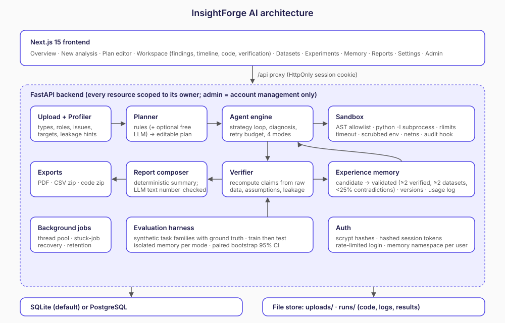

# InsightForge AI

InsightForge AI is an autonomous data-scientist web app. You upload a CSV or Excel file and ask a question in plain English. InsightForge then works through these steps:

1. Profiles the data.
2. Proposes a plan, which you can edit and approve.
3. Runs real Python and SQL in a sandbox.
4. Independently recomputes every key number.
5. Learns only from verified, repeated experience.

It runs **free by default**. No LLM or API key is required, because the planner and report writer are deterministic. A free local LLM (Ollama) or any OpenAI-compatible free tier can be plugged in optionally.



Screenshots from a real run are in `docs/screenshots/`.

---

## Quick start (local)

Requirements: Python 3.11+, Node 20+, Linux or macOS. On Linux, network isolation of sandboxed code uses `unshare -rn` when the kernel allows it.

```bash
# backend
cd backend
python3 -m venv .venv && . .venv/bin/activate
pip install -r requirements.txt
cp .env.example .env            # defaults are fine
python scripts/init_db.py       # creates DB + synthetic demo data
uvicorn app.main:app --port 8000

# frontend (new terminal)
cd frontend
cp .env.example .env.local      # BACKEND_URL=http://127.0.0.1:8000
npm install
npm run build && npm start      # or: npm run dev
```

Open http://localhost:3000 and register. **The first account becomes the admin.** Then click **Run the retail demo**.

Run the tests with `cd backend && python -m pytest -q`. There are 26 tests covering:

- The profiler.
- Sandbox security: blocked imports, file reads, eval and timeouts.
- Verifier mismatch detection and narrative number checks.
- Memory promotion rules.
- The planner.
- Per-user isolation and admin 403s.
- The full retail demo through the API, ending in a PDF.
- Fill-missing operations, missing-value reporting, the explorer, follow-ups that switch method, and share links (including revocation and no access for other users).

## Using it

| Page | What it does |
|---|---|
| Overview | Stats, recent work, the demo buttons, example questions |
| New analysis | Upload (CSV/XLSX, validated by magic bytes and size) or pick a dataset, then ask a question |
| Plan editor | Change the task type, columns, features, strategy order and retry budget before anything runs |
| Analysis workspace | Findings, metric cards, charts (with a data-table toggle), execution timeline, generated code, verification checks, experiments, and **Reproduce** |
| Datasets | Tabs: Overview, Quality dashboard, Clean (step editor with preview, every result saved as a new version), Ask, Predict, Patterns, Insights, Explore columns, Pipeline, Missing values. Export as CSV, XLSX, or an HTML/PDF report |
| Ask | Plain-English questions (totals, averages, counts, top N, filters, trends, correlations, distributions) answered with pandas. The exact code and equivalent SQL are shown, the interpretation can be corrected, and answers can be pinned or added to a dashboard |
| Predict | AutoML: a baseline and three models compared by cross-validation, the winner scored once on held-out data, identifiers and leaky columns excluded, Shapley explanations, a prediction form and what-if scenarios with confidence intervals |
| Patterns | Anomalies (with reasons), forecast tested against a naive baseline, and segments, each saying when the signal is weak |
| Insights | Automatic EDA: KPIs, ranked insights with test, sample size and adjusted q-values, trend, correlations, group tests |
| Pipeline | Versions (upload, cleaned, newer data), the cleaning steps, everything built on each version, upload of newer data, and a reproduce bundle that rebuilds the cleaned file without the app |
| Dashboards | Live tiles re-run on the latest data version. KPI tiles take alert rules, and alerts are recorded only when real new data breaches a rule |
| Experiments | Every strategy attempt, plus the 4-mode learning evaluation |
| Learning memory | Lessons with status, evidence, versions and usage; you can edit, reject or restore them |
| Reports | PDF, CSV tables zip, code zip |
| Dataset explorer | Histograms per column, top values, correlation heatmap (Explore tab) |
| Missing values | Per-column gap counts; fill with median, mean, most common or a constant, or drop rows, saved as a cleaned copy after confirmation |
| Follow-ups | Ask "try a different model", "why?" and similar on a finished analysis. The new plan keeps the parent's settings, is linked to it and is editable before it runs |
| Share | Read-only public link to a report (findings, charts, metrics, verification only). Only a token hash is stored, and the link can be revoked |
| Compare | Two analyses side by side, or two datasets: schema changes and per-column distribution shift (KS / chi-square with PSI, FDR-adjusted) |
| Settings | Agent mode, retry budget, LLM status, memory export, wipe my data |
| Admin | List, disable or delete accounts and see usage counts. **Admins cannot open other users' data.** |

## How it works

These are the main components:

- **Profiler.** Infers semantic types and roles (revenue, cost, date and so on) and finds missing values, duplicates, inconsistent categories, candidate targets and likely leakage columns.
- **Planner.** Rule-based intent classification across 9 task types: descriptive, comparison, hypothesis test, classification, regression, forecasting, segmentation, anomaly detection and profit change. It also maps columns and lists feasibility gaps. An LLM, if configured, can only refine choices within the allowed schema.
- **Analysis methods.** Parameterised, reviewed code templates rather than free-form generated code. Parameters are injected as JSON literals.
- **Sandbox.** Runs analysis code in four layers:
  1. AST validation with an import allowlist (no `os`, `subprocess`, `socket`, `eval`, `open` and so on).
  2. A `python -I` subprocess with CPU, memory and file-size rlimits, a timeout and a scrubbed environment.
  3. A network namespace (`unshare -rn`) when available.
  4. A runtime audit hook that blocks file access outside the run directory, process spawning and sockets.
- **Agent engine.** Tries strategies in order. When the verifier marks a result *weak* or *invalid*, it diagnoses why (class imbalance, assumption failure, poor fit and so on) and retries with a justified alternative, up to the retry budget.
- **Verifier.** Recomputes each numeric claim from the raw file independently of the sandbox. It also checks statistical assumptions, leakage, evidence links on findings, and causal wording. LLM-written text is accepted only if every number in it matches a verified value.
- **Memory.** Each experiment adds evidence to a lesson keyed by task type, strategy, outcome and data conditions (for example skew or imbalance). A lesson becomes **validated** only with ≥2 verified pieces of evidence from ≥2 different datasets and a contradiction rate below 25%. Every change is versioned, and every reuse is logged. Lessons can only *re-order* strategies; they never skip verification.
- **Agent modes.**
  - `baseline`: no memory.
  - `ordinary_memory`: uses all lessons, including unvalidated ones.
  - `validated_memory`: uses validated lessons only.
  - `validated_verified`: validated lessons plus verifier-triggered retries. This is the default.

## Measured evaluation (real run, not a claim of general learning)

Settings: 6 synthetic task families with known ground truth, 2 training seeds and 2 test seeds per family, memory isolated per mode, and a 178 s run on the dev container.

| Mode | Statistically valid choice | Correct answer | Attempts / task |
|---|---|---|---|
| baseline | 83% | 91.7% | 1.08 |
| ordinary_memory | 83% | 91.7% | 1.08 |
| validated_memory | 100% | 91.7% | 1.08 |
| validated_verified | 100% | 91.7% | 1.08 |

On skewed small samples, validated memory switched from Welch's t-test to Mann-Whitney. The validity gain (+0.17) has a paired bootstrap 95% CI whose lower bound touches 0, so **it is not a statistically significant improvement** at this sample size. Correctness did not change. You can re-run the evaluation with more seeds from the Experiments page.

## Free deployment

### One click (Render, free plan)

[](https://render.com/deploy?repo=https://github.com/Ranjithiyer05/insightforge-ai)

1. Click the button and sign in to Render with GitHub. No card is needed for free services.
2. Render reads `render.yaml` and creates two free services, `insightforge-api` and `insightforge-web`. It asks for these values:
   - `ADMIN_EMAILS`: your email.
   - `DATABASE_URL`: optional, but recommended. Paste a free Neon Postgres URL so accounts survive restarts.
   - `CORS_ORIGINS` and `BACKEND_URL`: leave them blank for now.
3. When `insightforge-api` is live, copy its URL (for example `https://insightforge-api.onrender.com`). Set it as `BACKEND_URL` on `insightforge-web`, and set the web URL as `CORS_ORIGINS` on the API. Both services redeploy automatically.
4. Open the web URL and register. The first account becomes the admin.

Keys are entered only in the Render dashboard and are never stored in the repo.

### Other free options


Everything below has a free tier. Set spending limits or "no card on file" wherever a provider asks. Keep `LLM_PROVIDER=none` or use Ollama to guarantee zero LLM cost.

| Part | Free option | Notes |
|---|---|---|
| Frontend | **Vercel** (Hobby) | Set the `BACKEND_URL` env var to your backend URL |
| Backend | **Render** free web service, **Hugging Face Spaces** (Docker), or **Fly.io** (small free allowance) | Start command: `uvicorn app.main:app --host 0.0.0.0 --port $PORT` |
| Database | **Neon** or **Supabase** free Postgres | `DATABASE_URL=postgresql+psycopg://…?sslmode=require` |

Free-tier caveats:

- **Sleep.** Render and HF free services sleep when idle, so the first request takes 30–60 s.
- **Ephemeral disk.** Uploaded files and run logs live in `INSIGHTFORGE_DATA_DIR` and are lost on redeploy unless you attach a persistent volume. Accounts, analyses and memory survive in Postgres. `DATASET_RETENTION_DAYS` deletes old uploads.
- **Limited memory.** Lower `SANDBOX_MEMORY_MB` to 512 and `MAX_UPLOAD_MB` to fit 512 MB instances.
- **No network namespace.** Many hosts block `unshare`. The sandbox then falls back to the audit hook, which blocks sockets, and the UI shows that netns isolation is off. Set `SANDBOX_REQUIRE_NETNS=1` to refuse to run instead.
- **HTTPS settings.** Behind HTTPS, set `COOKIE_SECURE=1` and set `CORS_ORIGINS` to your frontend URL. Put your email in `ADMIN_EMAILS`.

Others can then register and use it. Each user's datasets, analyses, experiments, evaluations and learning memory are private to them (requests for another user's IDs return 404).

## Performance

Measured with `python scripts/benchmark.py 100000` (each operation in a fresh process on a 4-core sandbox, so expect several times slower on Render's free plan). Details are in `docs/upgrade/09-final.md`.

| Operation | Retail demo (19,560 rows) | Synthetic (100,000 rows) |
|---|---|---|
| Profile | 0.3 s | 0.8 s |
| Automatic EDA | 0.7 s | 0.9 s |
| 4 Ask questions | 0.7 s | 0.9 s |
| Anomalies | 1.6 s | 3.6 s |
| Forecast | 0.8 s | 0.8 s |
| Segments | 2.9 s | 3.9 s |
| AutoML (4 models, 5-fold CV, explanations) | 29 s | 24 s (20,000-row sample) |

## Security notes

- The sandbox is **process-level isolation**, not a VM. For untrusted public use, run the backend inside a container with gVisor or Firecracker, a read-only root filesystem and no egress.
- Uploads are checked by extension, magic bytes and size. Stored names are server-generated, and CSV exports are protected against formula injection.
- Passwords are hashed with scrypt. Session tokens are stored only as SHA-256 hashes in HttpOnly SameSite cookies, and logins are rate-limited per account and per visitor address (taken from X-Forwarded-For behind a proxy).
- Demo (guest) accounts are limited per visitor and globally per hour, and are deleted within a day.
- Heavy endpoints (Ask, Patterns, predictions, scenarios, reports, comparisons) are capped per user per minute.
- Ask never executes user text. Questions become a validated spec, and the generated pandas code is run with only pandas, NumPy and a minimal set of builtins. Tests cover injection attempts.
- No raw data rows are sent to any LLM unless `ALLOW_LLM_SAMPLE_ROWS=1`.

## Feature status

**Implemented**

- Upload (CSV/XLSX), profiling, quality issues, cleaning with confirmation, preview and delete.
- Natural-language questions turned into an editable, approvable plan, covering 9 task types with feasibility checks.
- Sandboxed Python execution (pandas, SciPy, statsmodels, scikit-learn) and SQL (SQLite in memory) with a full step timeline, code and logs.
- Verifier that recomputes claims, checks assumptions and leakage, and gates narrative numbers.
- Retry with diagnosis, using the verifier's verdict and a retry budget.
- Validated experience memory with versions, a usage log, user edits, export, and per-user namespaces.
- The 4-mode evaluation harness with ground-truth tasks and bootstrap CIs.
- PDF, CSV and code exports, plus reproduce or re-run.
- Accounts, per-user isolation and the admin page.
- Dataset explorer, missing-value tools with a per-analysis "how missing values were handled" card, follow-up questions, read-only share links, and side-by-side comparison.
- Dark and light themes, a responsive layout, and synthetic retail and churn demos.
- Optional free LLM providers (Ollama or OpenAI-compatible) with the deterministic fallback.
- Upgrade (see `docs/upgrade/`): quality dashboard, versioned cleaning, automatic EDA, Ask your data, AutoML with Shapley explanations and what-if scenarios, dataset comparison, dataset reports, anomalies, forecasts and segments, dashboards with KPI monitoring, data versions, pipeline view and reproduce bundles, guest demo, command palette (Ctrl+K) and motion design.

**Partial**

- LLM integration only refines the plan and summary. It does not write analysis code (by design, for safety), so open-ended questions outside the 9 task types fall back to the closest template.
- Forecasting uses naive, seasonal-naive, linear trend or Holt-Winters chosen on a holdout. There is no Prophet or ARIMA search.
- AutoML compares fixed candidates without hyperparameter search, and is capped at 8,000 training rows on the free plan to keep it responsive.
- Network isolation depends on the host kernel (see the caveats).
- Search in the top bar matches names only.
- The evaluation is small (2+2 seeds per family). The harness supports more, but the numbers above are all that was measured.

**Not implemented yet / roadmap**

- Database connectors (Postgres, BigQuery and others) and files over about 1M rows.
- Container or VM-level sandboxing, and a job queue (Redis or Celery) for multi-instance scaling.
- Team workspaces and sharing analyses between accounts, password reset by email, and OAuth.
- Scheduled or recurring analyses and email alerts (KPI rules are checked when a dashboard is opened after new data arrives).
- Free-form conversational chat (follow-ups are planned analyses, not a chat thread).
